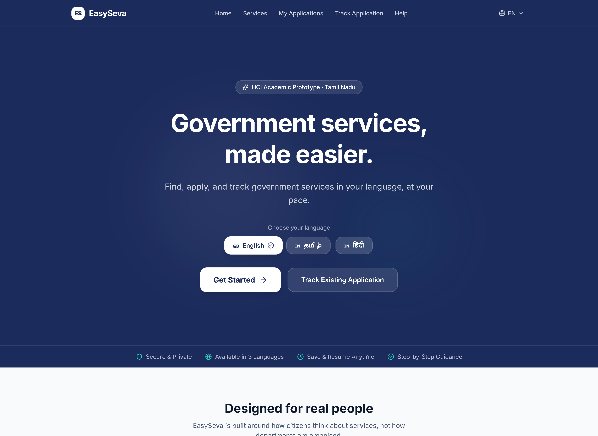
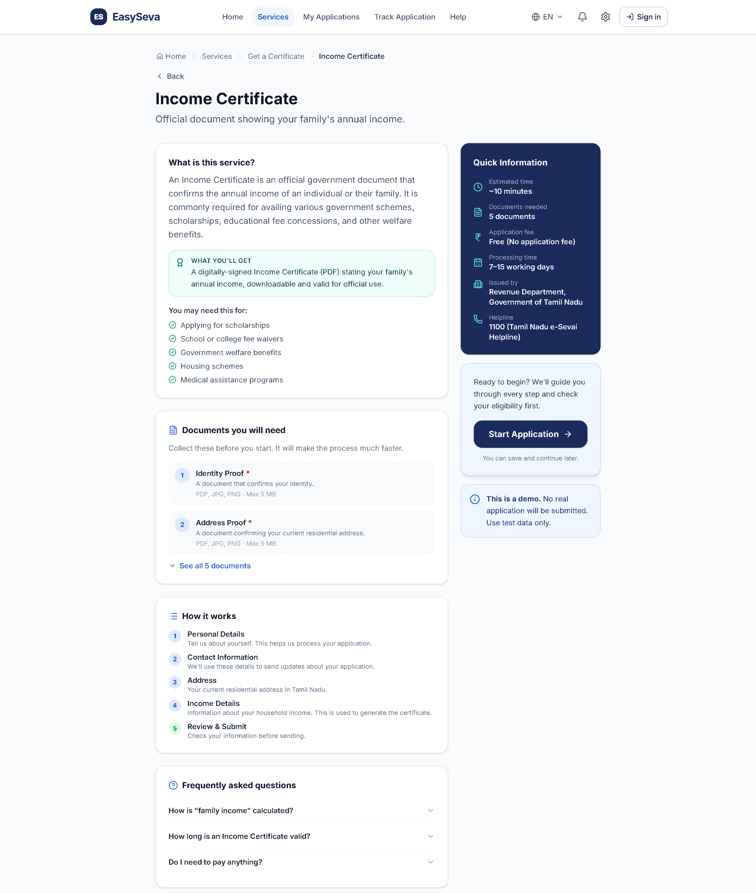
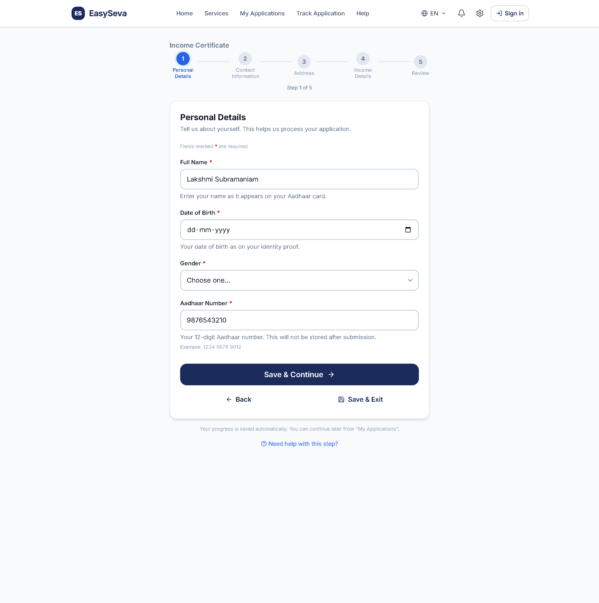
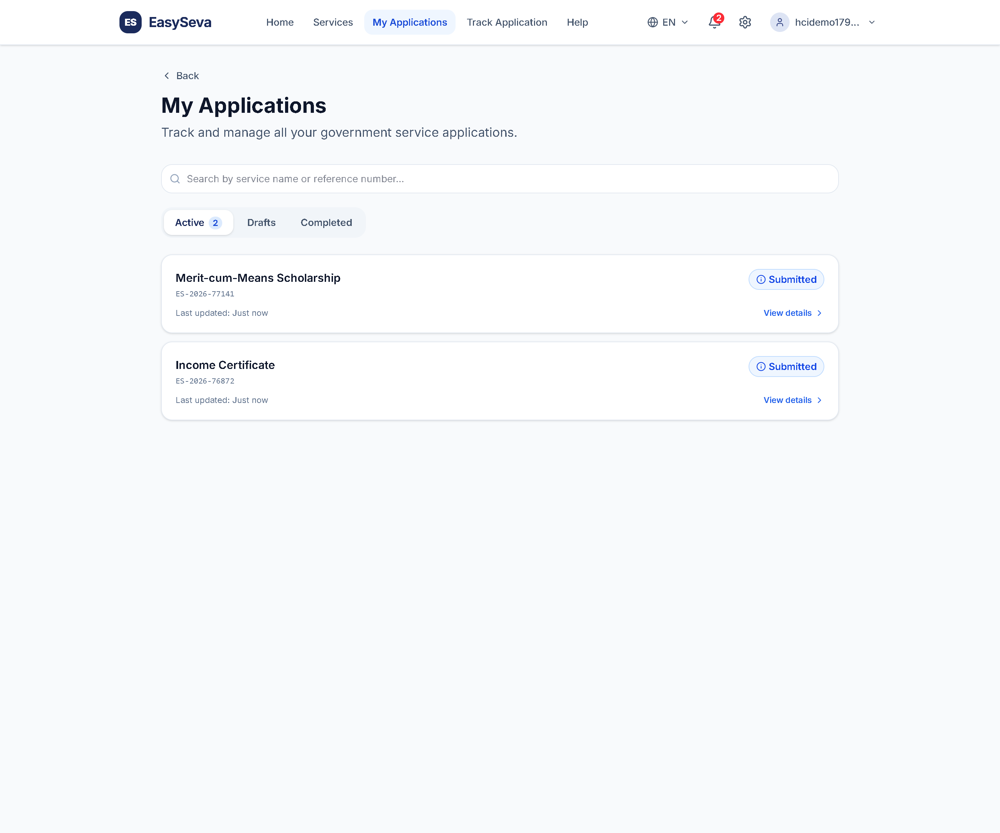

<div align="center">

# EasySeva — Government Services, Made Easier

**A citizen-first web portal to discover, apply for, and track government services — in your language, at your pace.**

[](https://easyseva-rho.vercel.app)
[](https://nextjs.org)
[](https://react.dev)
[]()

**Live app → https://easyseva-rho.vercel.app**

</div>



> **Academic prototype.** EasySeva is a Human–Computer Interaction (HCI) course
> project. All submissions are simulated and no real government data is processed —
> please do not enter real personal information.

---

## 👥 Team

| Name | Registration No. |
| --- | --- |
| Rohith Ganesh Kanchi | 23BCE5049 |
| S D Madhumitha | 23BCE5058 |
| S Azhagesh | 23BCE1205 |

**Course:** Human–Computer Interaction  **Faculty:** Dr. Kabilan K
**Institution:** Vellore Institute of Technology

📄 **Full HCI design report (with per-page principle analysis and screenshots):**
[`docs/report/EasySeva_HCI_Report.pdf`](docs/report/EasySeva_HCI_Report.pdf)

---

## 🧭 What is EasySeva?

Applying for a government document — an income certificate, a scholarship, a ration
card, a pension — is something almost every household faces, yet the digital
experience is usually intimidating: dense 30-field forms, unexplained jargon,
English-only interfaces, no way to save progress, and cryptic status updates.

EasySeva reimagines that experience around **how citizens think**, not how
departments are organised. It is designed for first-time and low-digital-literacy
users and makes applying calm, guided, and forgiving.

## ✨ Features

- **9 services** across 6 citizen-centred categories (Certificates, Benefits,
  Education, Family, Senior Citizen, Document Updates).
- **Guided application flow** — eligibility check → document checklist → chunked
  form → review → confirmation.
- **Passwordless OTP login** (email; shown on-screen in demo mode).
- **Save & resume** drafts, and **application tracking** by reference number.
- **Rich service detail** — processing time, issuing department, helpline,
  "what you'll get", FAQs, and related services.
- **Trilingual** interface: English, தமிழ் (Tamil), हिंदी (Hindi).
- **Accessibility built in** — large-text and high-contrast modes, reduced motion,
  skip links, visible focus, ARIA semantics, 44px+ touch targets.
- **Responsive** — reflows to a single column with a thumb-friendly bottom nav on
  mobile.

## 🗂 Services

| Category | Services |
| --- | --- |
| Certificates | Income Certificate · Community Certificate |
| Benefits | Destitute Widow Pension |
| Education | Merit-cum-Means Scholarship |
| Family | Birth Certificate · Marriage Certificate · New Ration Card |
| Senior Citizen | Old Age Assistance Pension |
| Document Updates | Patta / Chitta Land Record |

## 🧠 HCI principles (summary)

EasySeva is designed against Nielsen's 10 heuristics, Shneiderman's 8 golden
rules, Norman's interaction principles, and the WCAG POUR pillars. A few examples:

| Principle | How it shows up |
| --- | --- |
| Visibility of system status | Progress bars, status badges, timelines, confirmation with reference number |
| Match the real world | Task-based categories, plain-language labels and statuses |
| Error prevention | Eligibility pre-check, inline validation, confirm-before-submit, OTP vs passwords |
| Recognition over recall | Document examples, review summary, breadcrumbs |
| User control & freedom | Save & resume, editable review, cancellable dialogs |
| Flexibility & efficiency | 3 languages, search + guided finder, tracking without login |
| Accessibility (POUR) | High-contrast / large-text / reduced-motion modes, keyboard + ARIA |

See the [full report](docs/report/EasySeva_HCI_Report.pdf) for an in-depth,
page-by-page analysis of every principle used.

### A few screens

| Service detail | Guided form | Application tracking |
| --- | --- | --- |
|  |  |  |

## 🛠 Tech stack

- **Next.js 16** (App Router, Turbopack) · **React 19** · **TypeScript**
- **Tailwind CSS v4** with a custom design-token theme
- **Prisma** ORM · **PostgreSQL** (Neon in production)
- **jose** (JWT session cookies) · **nodemailer** / **Resend** (OTP email)
- **Jest** + **ts-jest** (64 unit tests)
- Deployed on **Vercel**

## 🚀 Getting started (local)

### Prerequisites
- Node.js 20+ (22 recommended)
- A PostgreSQL database

```bash
# 1. Install dependencies (also runs `prisma generate`)
npm install

# 2. Configure environment
cp .env.example .env            # set DATABASE_URL and JWT_SECRET

# 3. Apply the database schema
npm run db:migrate

# 4. Start the dev server
npm run dev
```

Open http://localhost:3000. With SMTP/Resend unset, the OTP is shown on the
verification screen (demo mode), so you can log in without configuring email.

## 🧪 Testing

```bash
npm test             # 64 unit tests
npm run test:coverage
```

## ☁️ Deployment

Deploys to any Node host with a PostgreSQL database. For Vercel, add a Neon
Postgres (sets `DATABASE_URL`) and `JWT_SECRET`; the build runs
`prisma generate && prisma migrate deploy && next build`, so the schema is created
on first deploy. Full instructions: [`DEPLOYMENT.md`](DEPLOYMENT.md).

## 📁 Project structure

```
app/                 App Router routes (pages + API route handlers)
  apply/[service]/   Multi-step flow: eligibility → documents → form → review → confirmation
  services/          Service discovery and detail pages
  api/               Auth, applications, payment, upload, notifications, profile
components/          ui/ primitives · features/ domain components · layout/
context/             Auth and global app-state providers
lib/                 Prisma client, auth, utils, translations, service catalogue
prisma/              Schema and migrations
__tests__/           Jest unit tests
docs/report/         HCI report (LaTeX + PDF) and website screenshots
```

## 📄 License

Academic / educational use.
